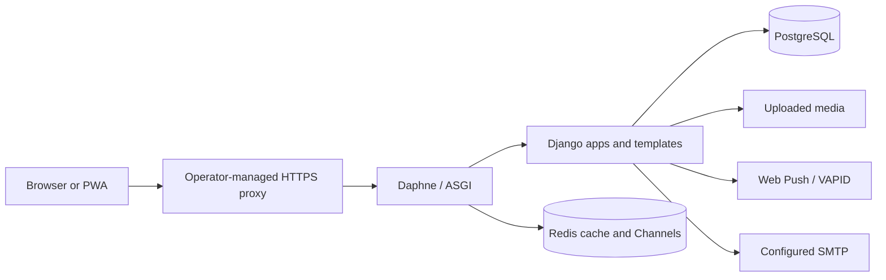

# Architecture

Reviewed 2026-11-12 against the current repository. This is a source map, not an assurance that every deployment option has been exercised.

## Runtime shape

Campus Nexus is a Django project served through ASGI. Daphne is installed and used by the Docker image; Django Channels routes HTTP and WebSocket connections. PostgreSQL is the Compose database, Redis backs the production cache and channel layer, and static and uploaded media use filesystem volumes in the supplied container setup.

The reverse proxy, TLS, monitoring, and backup services are operator responsibilities; they are not defined by the checked-in Compose file.

## Main code areas

| Path | Responsibility |
| --- | --- |
| `campus/` | Django settings, root URLs, ASGI/WSGI entry points, operations views, API, and Channels setup. |
| `accounts/` | User model, applications, authentication, profiles, settings, social features, and directory. |
| `coordinate/` | Ride workflows, scheduling, chat consumers, ride policies, and templates. |
| `templates/` | Server-rendered pages, including the mobile-responsive user interface. |
| `static/` | CSS, JavaScript, icons, PWA manifest, and service worker. |
| `scripts/` | Build, deployment support, and multi-worker utilities. |
| `load-testing/` | Locust workloads, monitors, and archived run output. |

See the [project map](../PROJECT_MAP.md) for navigation. Source paths and URL patterns are authoritative.

## Settings modules and dependencies

- `campus.settings.base` defines common applications, middleware, templates, auth, database aliases, cache defaults, and Channels configuration.
- `campus.settings.dev` relaxes host/security settings for local use, uses a faster password hasher, and can fall back to in-memory Channels and console email.
- `campus.settings.prod` requires explicit production settings, rejects weak secret keys and unsafe hosts, and configures Redis, static storage, WebAuthn, and web push.
- `campus.settings.test` uses in-memory databases, cache, and Channels, plus isolated temporary test media.

Configuration templates are `.env.example` for local development and `.env.docker.example` for container deployment. Do not copy values from a local `.env` or development settings into production.

`base.py` declares the `default`, `permanent`, and `guest_demo` database aliases. Guest demo ride records explicitly use the `guest_demo` alias. Early-launch isolation claims are under review because the inspected runserver implementation does not clearly configure the documented temporary alias; see the [documentation audit](DOCUMENTATION_AUDIT.md).

## HTTP and realtime entry points

- Root routes and operations tools are registered in `campus/urls.py`.
- Account routes are in `accounts/urls.py`; ride routes are in `coordinate/urls.py`.
- The REST API is mounted under `/api/v1/`; current routes are listed in the [API reference](API_REFERENCE.md).
- WebSocket routes are declared in `coordinate/routing.py` and included by `campus/asgi.py`:
  - `/ws/ride/<ride_id>/`
  - `/ws/chat/direct/<friend_enrollment>/`
  - `/ws/notifications/`
  - `/ws/operations/`
  - `/ws/applications/`
- Health checks are available at `/health/` and `/healthz/`.
- The root service worker and manifest endpoints are `/sw.js` and `/manifest.json`.

## Data and privacy boundaries

The custom user model is `accounts.User`. Ride and participant data are defined in `coordinate/models.py`. Guest demo rides are written through the `guest_demo` database alias and tagged to the demo session; normal student ride data is queried separately and redacted for demo visitors. Guest mode blocks directory, profile, messaging, WebSocket, and protected-media access in the relevant application paths.

These are code-level mechanisms, not a substitute for deployment testing. Consult [Guest demo and privacy](GUEST_DEMO_AND_PRIVACY.md) and verify the current policies before changing a data boundary.

## Documentation notes

Older documents include non-current schema details, absolute workstation paths, unsupported performance claims, and test totals without a revision. The [documentation audit](DOCUMENTATION_AUDIT.md) records confirmed mismatches and open verification work. Historical audit and benchmark reports should remain labeled as snapshots.
