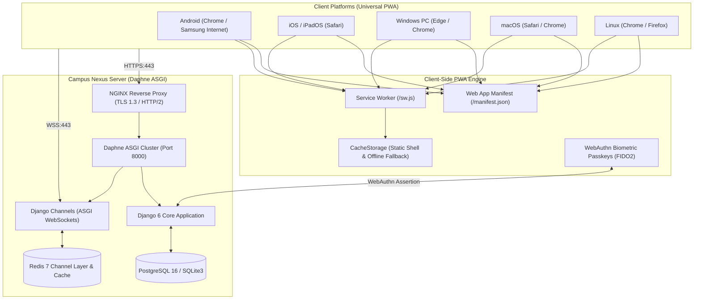

# Campus Nexus — Cross-Platform Mobile & Desktop Architecture (Progressive Web Application — PWA)

## Executive Summary
Campus Nexus adopts a **Universal Progressive Web Application (PWA)** architecture across mobile (Android, iOS) and desktop (Windows, macOS, Linux) environments. This architectural choice replaces traditional native app frameworks (such as React Native / Flutter) to deliver a frictionless, zero-install, native-grade experience across the entire student body without app store friction, developer account fees, or distribution gatekeeping.

In accordance with institutional guidelines:
- **Zero Payment / Zero Fare Splitting:** The mobile platform strictly excludes financial transactions, payments, and fare splitting. It functions solely as a verified peer-to-peer student mobility and campus coordination platform.
- **Standby Waitlist Management:** Full rides feature an automated standby queue with real-time push and WebSocket promotions.
- **Strict Gender Segregation:** Girls-Only, Boys-Only, and Open rides are enforced across UI, API, and database check constraints.
- **Privacy & Trust:** Physical root of trust with in-person verification, redaction of phone numbers from non-co-passengers, and isolated sandbox preview (Guest Demo Mode).

---

## 1. Architectural Decision: Why PWA Over React Native & App Stores

| Dimension | Native / React Native App | Universal Progressive Web App (PWA) | Campus Nexus Advantage |
| :--- | :--- | :--- | :--- |
| **Distribution** | Google Play Store & Apple App Store | Direct Institute URL (`campus-nexus.institute`) | **Zero store gatekeeping:** No developer fees ($99/yr Apple, $25 Google), no review queues or rejections. |
| **Student Friction** | 40–80 MB download, manual updates | Instant load, 1-tap "Add to Home Screen / Install" (< 1 MB) | **Instant onboarding:** Commuter students coordinate rides immediately without waiting for downloads. |
| **Release Velocity** | Multi-day review cycles for every bug fix | Continuous atomic deployment on Daphne cluster | **Zero-lag releases:** Security patches and schedule updates are instantly live across all devices. |
| **Cross-Platform Scope** | Separate builds for Android & iOS; no desktop | Unified codebase: Android, iOS, Windows, macOS, Linux | **100% Student Reach:** Works on budget Android phones, iPhones, campus lab PCs, and student laptops. |
| **Storage & Performance** | Heavy device storage and memory overhead | Cached via Service Worker (`/sw.js`) with instant start | **Lightweight:** Negligible device footprint; smooth 60 FPS transitions using modern CSS & GPU acceleration. |
| **Authentication** | Custom keystores and token refresh flows | WebAuthn FIDO2 Biometric Passkeys + 2-Week Sessions | **Hardware Biometrics:** Fingerprint, Face ID, Touch ID, and Windows Hello natively supported. |

---

## 2. Technical Stack & Architecture

### Core Technologies
- **Web App Manifest (`/manifest.json`):** Defines standalone display mode, theme colors (`#08B74F`), maskable and standard icons (192x192, 512x512), application title, and navigation shortcuts.
- **Service Worker (`/sw.js`):** Intercepts network requests using a cache-first strategy for static assets (CSS, JS, fonts, SVG) and a network-first strategy for dynamic ride data, with graceful fallback to `/offline/` during network disconnects.
- **WebAuthn / FIDO2 Passkeys:** Native browser hardware authentication utilizing the platform authenticator (Android fingerprint, Apple Touch ID / Face ID, Windows Hello).
- **Django Channels (ASGI WebSockets):** Real-time bidirectional WebSocket pipes for in-ride group chat, 1-on-1 direct messaging, and instant notification dispatches.
- **WhiteNoise Static Engine:** Compressed static asset delivery with immutable caching headers and cache busting.

---

## 3. Platform Capabilities Matrix

| Feature | Android (Chrome/Edge) | iOS / iPadOS (Safari) | Windows 10/11 (Chrome/Edge) | macOS (Safari/Chrome) | Linux (Chrome/Firefox) |
| :--- | :---: | :---: | :---: | :---: | :---: |
| **Standalone Fullscreen** | ✅ Native | ✅ Native | ✅ Native Window | ✅ Native Window | ✅ Native Window |
| **1-Click Install CTA** | ✅ `beforeinstallprompt` | ✅ Share > Add to Home | ✅ Address bar / prompt | ✅ Dock / Address bar | ✅ Address bar / prompt |
| **Offline Shell & Fallback** | ✅ Service Worker | ✅ Service Worker | ✅ Service Worker | ✅ Service Worker | ✅ Service Worker |
| **2-Week Biometric Sessions** | ✅ Fingerprint | ✅ Touch ID / Face ID | ✅ Windows Hello | ✅ Touch ID | ✅ Security Key |
| **Web Push Notifications** | ✅ Native Web Push | ✅ Web Push (iOS 16.4+) | ✅ Native Windows Alerts| ✅ macOS Notification Center | ✅ System Notifications |
| **Responsive UI Settings** | ✅ Mobile Drawer | ✅ Mobile Drawer | ✅ Navbar & Settings Modal | ✅ Navbar & Settings Modal | ✅ Navbar & Settings Modal |

---

## 4. Key Subsystem Specifications

### 4.1. 2-Week Persistent Sessions & Biometric Passkey Login
In downloaded standalone applications (`display-mode: standalone` or `nexus_standalone_app=1`):
1. **14-Day Session Age:** When authenticated inside the standalone app, the Django session cookie expiry is extended to `14 * 86400` (1,209,600 seconds = 14 days).
2. **Idle Timeout Exemption:** The `IdleSessionTimeoutMiddleware` recognizes standalone app requests (`X-Nexus-App=1` or `nexus_standalone_app=1`) and extends inactivity thresholds to 14 days.
3. **Remembered User Cookie:** A secure, Lax cookie `nexus_app_remembered_user` is stored on the client.
4. **1-Touch Biometric Sign-In:** Returning users on the login screen are presented with the passkey fast-sign-in card. Clicking **"Sign In with Passkey"** negotiates a cryptographic challenge without requiring password entry.

### 4.2. Service Worker & Offline Caching Architecture
- **Cache Name:** `campus-nexus-v1`
- **Pre-cached Shell:** `/offline/`, CSS stylesheets, brand favicons, and core web fonts.
- **Offline Fallback:** If a navigation request fails while traveling across disconnected highway stretches, the service worker immediately serves `/offline/` containing:
  - Cached emergency campus security numbers.
  - Active ride contact guidelines.
  - Connection retry monitor with auto-reload upon reconnection.

### 4.3. Post-Login Installation Prompting
- When users sign in via a standard browser, the dashboard renders `#postLoginPwaPrompt`.
- **Platform Customization:** Client JavaScript inspects `navigator.userAgent` and dynamically customizes the prompt title and button (e.g., *"Install on Windows"*, *"Install for Android"*, *"Install on Mac"*).
- **Standalone Guard:** If `isRunningStandalone()` returns `true`, the prompt is permanently suppressed.
- **Smart Dismissal:** Tapping *"Remind Later"* records a 7-day suppression in `localStorage`.

### 4.4. Programmatic REST API v1
For administrative scripts, automated integrations, and institutional partners:
- Versioned REST endpoints under `/api/v1/` remain active.
- Bearer session token authentication and `django-cors-headers` support headless access with full WebSocket parity.
