# Campus Nexus & COORDINATE — System Documentation Hub

> **Institution:** National Institute of Technology Srinagar (NIT Srinagar)  
> **Platform Version:** 2.5.0 (Guest Demo & Multi-Ride Release)  
> **Repository:** [Campus Nexus](https://github.com/Abdus-Samad-Saiyed/Campus-Nexus)  
> **Maintainer:** Abdus Samad Saiyed (`2024BCSE065`)  
> **Test Suite Status:** 322/322 Tests Passing (100%)  

---

## 1. Documentation Directory & Sitemap

Welcome to the central documentation suite for **Campus Nexus** and its flagship transit module **COORDINATE**. All architectural specifications, operational manuals, security audits, and client guides are organized modularly below:

### 🏛️ System Architecture & Domain Logic

| Document | Primary Audience | Core Topics Covered |
| :--- | :--- | :--- |
| [**`ARCHITECTURE.md`**](file:///s:/Campus-Project/docs/ARCHITECTURE.md) | Developers, Architects | Django 6 + Channels 4 ASGI architecture, WebSockets, umbrella service catalogue, ERD database schema, and telemetry middleware. |
| [**`GUEST_DEMO_AND_PRIVACY.md`**](file:///s:/Campus-Project/docs/GUEST_DEMO_AND_PRIVACY.md) | Reviewers, Security Auditors | Isolated third database (`guest_demo.sqlite3`), ephemeral session sandbox, zero student data leakage, ride browser redactions, and quarantine policies. |
| [**`MULTI_RIDE_SCHEDULING.md`**](file:///s:/Campus-Project/docs/MULTI_RIDE_SCHEDULING.md) | Developers, Product Leads | Multi-ride scheduling for round-trips/vacations, 2-hour non-overlapping buffer rules, conflict prevention across views/APIs, and student responsibility model. |
| [**`AUTHENTICATION_AND_SECURITY.md`**](file:///s:/Campus-Project/docs/AUTHENTICATION_AND_SECURITY.md) | Security Auditors, Devs | Dual-channel OTP (MIME/SMTP + SMS), Single-session enforcer, WebAuthn/FIDO2 biometric passkeys, 10-minute grace windows, and affirmative consent. |
| [**`MECHANICAL_ZEN_AND_THEMES.md`**](file:///s:/Campus-Project/docs/MECHANICAL_ZEN_AND_THEMES.md) | Frontend Engineers, Designers | Real-time SVG clockwork hands, ambient gear physics, foreground scatter animation with hesitation/rocket exit, eccentric light mode dialogues, and transitions. |

### 🚀 Operations, DevOps & Infrastructure

| Document | Primary Audience | Core Topics Covered |
| :--- | :--- | :--- |
| [**`DEPLOYMENT.md`**](file:///s:/Campus-Project/docs/DEPLOYMENT.md) | DevOps, System Admins | Full production handbook: PostgreSQL 16 migration, Redis 7 clustering, NGINX reverse proxy, Daphne systemd services, Cloudflare tunnels, and TLS 1.3. |
| [**`OPERATIONS_AND_ADMINISTRATION.md`**](file:///s:/Campus-Project/docs/OPERATIONS_AND_ADMINISTRATION.md) | Campus Admins, Staff | Operations dashboard, in-person physical verification desk, account soft-deletion with audit preservation, and CSV data exports. |
| [**`CAMPUS_SECRETS_CREDENTIALS.md`**](file:///s:/Campus-Project/CAMPUS_SECRETS_CREDENTIALS.md) | DevOps, Developers | Environment secrets configuration, Google SMTP relay setup, SMS carrier gateway credentials, and local development accounts. |

### 📱 Client Applications & API Specifications

| Document | Primary Audience | Core Topics Covered |
| :--- | :--- | :--- |
| [**`API_REFERENCE.md`**](file:///s:/Campus-Project/docs/API_REFERENCE.md) | Mobile/Client Devs | Versioned REST API (v1) endpoints, JSON schemas, Bearer token authentication challenge workflows, and Channels WebSocket packet protocol. |
| [**`MOBILE_ARCHITECTURE.md`**](file:///s:/Campus-Project/docs/MOBILE_ARCHITECTURE.md) | Mobile Engineers (React Native) | Android app design (Expo SDK 51+, TypeScript), Zustand reactive state, TanStack React Query, secure keystore storage, and background notification triggers. |
| [**`MOBILE_SCAFFOLDING.md`**](file:///s:/Campus-Project/docs/MOBILE_SCAFFOLDING.md) | Mobile Engineers | Directory structure, client boilerplate, WebSocket manager class, and implementation checklist for the Android client. |

### 🔍 Philosophy, Audits & Codebase Taxonomy

| Document | Primary Audience | Core Topics Covered |
| :--- | :--- | :--- |
| [**`MANIFESTO.md`**](file:///s:/Campus-Project/MANIFESTO.md) | Everyone | Engineering as a mindset, solving everyday campus friction, the Spectre/CrowdStrike inspiration, cold-start solutions, and student contribution legacy. |
| [**`PROJECT_MAP.md`**](file:///s:/Campus-Project/PROJECT_MAP.md) | All Contributors | Exhaustive 30KB codebase taxonomy, architectural mapping, file-by-file directory guide, database schemas, and service breakdown. |
| [**`BUG_REGISTER.md`**](file:///s:/Campus-Project/docs/BUG_REGISTER.md) | QA, Security Auditors | Audit-driven bug register tracking all P0–P3 security vulnerabilities, race conditions, concurrency safeguards, and verification proofs. |
| [**`AUDIT_BASELINE.md`**](file:///s:/Campus-Project/docs/AUDIT_BASELINE.md) | Auditors | Phase 0 baseline architectural inventory, dependency matrix, and initial boundary assessments. |

---

## 2. Recommended Reading Order by Persona

```mermaid
flowchart TD
    subgraph Reviewer ["External Reviewers & Evaluators"]
        R1["MANIFESTO.md"] --> R2["GUEST_DEMO_AND_PRIVACY.md"] --> R3["ARCHITECTURE.md"]
    end

    subgraph Backend ["Backend & Security Engineers"]
        B1["ARCHITECTURE.md"] --> B2["AUTHENTICATION_AND_SECURITY.md"] --> B3["MULTI_RIDE_SCHEDULING.md"] --> B4["BUG_REGISTER.md"]
    end

    subgraph Mobile ["Mobile & Client Developers"]
        M1["API_REFERENCE.md"] --> M2["MOBILE_ARCHITECTURE.md"] --> M3["MOBILE_SCAFFOLDING.md"]
    end

    subgraph DevOps ["DevOps & Operations Staff"]
        D1["DEPLOYMENT.md"] --> D2["OPERATIONS_AND_ADMINISTRATION.md"] --> D3["CAMPUS_SECRETS_CREDENTIALS.md"]
    end
```



---

## 3. Platform Architecture Overview

```
                               +----------------------------------------+
                               |          CAMPUS NEXUS UMBRELLA         |
                               +-------------------+--------------------+
                                                   |
                 +--------------------+------------+
                 |                                 |
                 v                                 v
          [ COORDINATE ]                      [ GUEST DEMO ]
       (Live — Ridesharing)              (Isolated Ephemeral Sandbox)
                 |                                 |
                 +---> Multi-Ride Scheduling (2-Hour Non-Overlapping Buffer)
                 +---> Dual-Channel OTP (MIME/SMTP Email + Carrier SMS)
                 +---> WebAuthn / FIDO2 Passkeys (Windows Hello / Touch ID)
                 +---> Single-Session Device Enforcer
                 +---> Physical Operations Desk & In-Person Verification
                 +---> Clockwork Watermark & Zen Transition Engine
```

---

## 4. Quickstart & Verification Commands

### Development Setup
```powershell
# Activate Python Virtual Environment
.\venv\Scripts\activate

# Install Dependencies
pip install -r requirements.txt

# Run Migrations across All Configured Databases
python manage.py migrate
python manage.py migrate --database=guest_demo

# Seed Initial Debug Accounts
python manage.py create_debug_accounts --reset
```

### Automated Audit & Test Suites
```powershell
# Run Full Test Suite (322/322 Tests Passing)
python manage.py test --settings=campus.settings.test

# Run Guest Demo Mode Isolation Tests (11 Tests)
python manage.py test coordinate.test_guest_demo --settings=campus.settings.test

# Run Multi-Ride Scheduling Tests (4 Tests)
python manage.py test coordinate.test_multi_ride --settings=campus.settings.test
```

### Launch Development Server
```powershell
# Standard Local Development
python manage.py runserver 127.0.0.1:8000

# Fast-Track Early Launch Mode (Temporary Self-Declaration Database)
python manage.py runserver 127.0.0.1:8000 --early-launch
```
