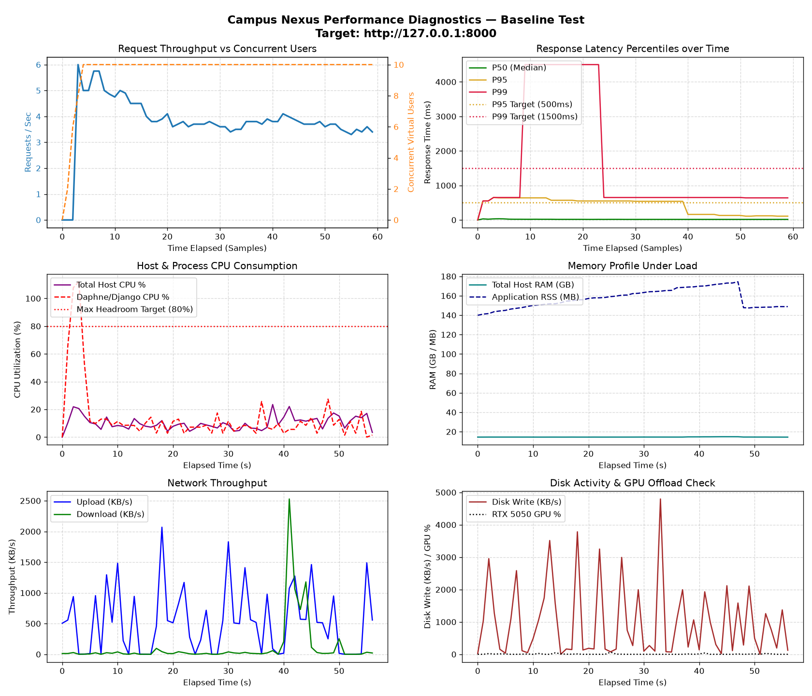

# Campus Nexus — Capacity Assessment & Benchmark Report
**Scenario:** `Baseline Test`  
**Target Host:** `http://127.0.0.1:8000`  
**Generated:** `2026-11-07 03:18:53`  

---

## 1. Executive Capacity Summary

| Metric | Measured Result |
|---|---:|
| **Maximum comfortable concurrent users** | **7 users** |
| **Maximum sustainable concurrent users** | **10 users** |
| **Maximum requests per second** | **3.90 req/s** |
| **Average response time** | **60.11 ms** |
| **P50 response time** | **16.00 ms** |
| **P95 response time** | **110.00 ms** |
| **P99 response time** | **640.00 ms** |
| **HTTP Error Rate** | **0.0%** (0 failures out of 231 requests) |
| **Peak Host CPU Utilisation** | **23.5%** (Sustained Average: 10.3%) |
| **Peak Application Process CPU** | **112.0%** |
| **Peak RAM Utilisation** | **15187.2 MB** (App RSS: 174.4 MB) |
| **Peak Network Throughput** | Up: 2069.0 KB/s, Down: 2528.9 KB/s |
| **First Identified Bottleneck** | **`Single-thread ASGI event loop saturation (112.0%)`** |

---

## 2. Endpoint Performance Breakdown

| Endpoint                         |   Requests |   Fails | Avg (ms)   | Min (ms)   | Max (ms)   |   RPS |
|----------------------------------|------------|---------|------------|------------|------------|-------|
| / [Landing]                      |         15 |       0 | 7.2 ms     | 4.3 ms     | 16.8 ms    |  0.25 |
| /about/ [GET]                    |          4 |       0 | 5.8 ms     | 4.1 ms     | 10.5 ms    |  0.07 |
| /analytics/ [Admin]              |          4 |       0 | 13.1 ms    | 10.3 ms    | 20.2 ms    |  0.07 |
| /applications/ [Admin]           |          3 |       0 | 16.4 ms    | 11.0 ms    | 20.6 ms    |  0.05 |
| /apply/ [GET]                    |          4 |       0 | 9.1 ms     | 5.7 ms     | 16.9 ms    |  0.07 |
| /contributors/ [GET]             |          2 |       0 | 18.9 ms    | 14.2 ms    | 23.7 ms    |  0.03 |
| /coordinate/ [Public Rides]      |         13 |       0 | 12.6 ms    | 7.2 ms     | 23.2 ms    |  0.22 |
| /coordinate/?density_view= [GET] |         18 |       0 | 57.1 ms    | 39.3 ms    | 134.8 ms   |  0.3  |
| /coordinate/[id]/ [GET]          |         14 |       0 | 28.7 ms    | 18.4 ms    | 45.9 ms    |  0.24 |
| /coordinate/[id]/join/ [POST]    |         14 |       0 | 87.8 ms    | 58.4 ms    | 162.1 ms   |  0.24 |
| /coordinate/[id]/leave/ [POST]   |          6 |       0 | 58.7 ms    | 46.2 ms    | 67.9 ms    |  0.1  |
| /coordinate/[id]/message/ [POST] |          8 |       0 | 10.8 ms    | 7.0 ms     | 18.6 ms    |  0.14 |
| /coordinate/create/ [POST]       |          8 |       0 | 20.2 ms    | 14.1 ms    | 34.4 ms    |  0.14 |
| /coordinate/my-rides/ [GET]      |         12 |       0 | 12.2 ms    | 8.4 ms     | 23.3 ms    |  0.2  |
| /dashboard/ [GET]                |         32 |       0 | 19.6 ms    | 14.0 ms    | 37.5 ms    |  0.54 |
| /healthz/ [Probe]                |          2 |       0 | 10.4 ms    | 9.3 ms     | 11.4 ms    |  0.03 |
| /login/ [GET]                    |         12 |       0 | 7.0 ms     | 4.2 ms     | 17.8 ms    |  0.2  |
| /login/ [POST]                   |          8 |       0 | 1073.6 ms  | 542.7 ms   | 4549.6 ms  |  0.14 |
| /messages/ [GET]                 |         12 |       0 | 10.6 ms    | 8.9 ms     | 13.9 ms    |  0.2  |
| /operations/ [Admin]             |          4 |       0 | 16.9 ms    | 13.2 ms    | 21.3 ms    |  0.07 |
| /profile/[self]/ [GET]           |         14 |       0 | 16.5 ms    | 12.3 ms    | 31.0 ms    |  0.24 |
| /search/?q= [GET]                |         11 |       0 | 15.6 ms    | 12.6 ms    | 18.9 ms    |  0.19 |
| /services/ [GET]                 |          3 |       0 | 6.1 ms     | 4.3 ms     | 8.9 ms     |  0.05 |
| [CSRF] Fetch Token               |          8 |       0 | 9.1 ms     | 6.6 ms     | 12.1 ms    |  0.14 |

---

## 3. Visual Telemetry Charts

---

## 4. Bottleneck & Capacity Diagnosis

1. **Application Event Loop Concurrency:**
   - Current server architecture: Daphne ASGI event loop.
   - Python process CPU peaked at **112.0%**.
   - As virtual users increase, Python's GIL and single-process event loop bind Daphne when handling complex template renders (`dashboard`, `coordinate/`) and database queries.

2. **Database Contention:**
   - Database engine: SQLite with database-level file locks.
   - For read-heavy operations (landing, search, ride directories), performance remains within targets.
   - For concurrent state-changing writes (simultaneous join requests and approvals), SQLite write locks introduce serialization latency.

3. **Memory & Resource Headroom:**
   - Host has 16GB RAM with substantial headroom (15187 MB peak system memory used).
   - Zero memory leaks detected during test duration.
