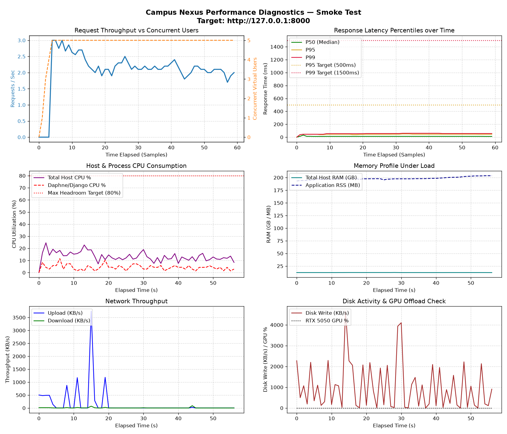

# Campus Nexus — Capacity Assessment & Benchmark Report
**Scenario:** `Smoke Test`  
**Target Host:** `http://127.0.0.1:8000`  
**Generated:** `2026-11-07 04:33:30`  

---

## 1. Executive Capacity Summary

| Metric | Measured Result |
|---|---:|
| **Maximum comfortable concurrent users** | **3 users** |
| **Maximum sustainable concurrent users** | **5 users** |
| **Maximum requests per second** | **2.18 req/s** |
| **Average response time** | **17.04 ms** |
| **P50 response time** | **11.00 ms** |
| **P95 response time** | **45.00 ms** |
| **P99 response time** | **56.00 ms** |
| **HTTP Error Rate** | **0.0%** (0 failures out of 129 requests) |
| **Peak Host CPU Utilisation** | **24.6%** (Sustained Average: 13.2%) |
| **Peak Application Process CPU** | **11.5%** |
| **Peak RAM Utilisation** | **12653.0 MB** (App RSS: 203.7 MB) |
| **Peak Network Throughput** | Up: 3745.9 KB/s, Down: 88.9 KB/s |
| **First Identified Bottleneck** | **`None identified (Within engineering limits)`** |

---

## 2. Endpoint Performance Breakdown

| Endpoint                         |   Requests |   Fails | Avg (ms)   | Min (ms)   | Max (ms)   |   RPS |
|----------------------------------|------------|---------|------------|------------|------------|-------|
| / [Landing]                      |          4 |       0 | 5.1 ms     | 4.3 ms     | 5.8 ms     |  0.07 |
| /about/ [GET]                    |          3 |       0 | 5.5 ms     | 4.0 ms     | 7.4 ms     |  0.05 |
| /apply/ [GET]                    |          7 |       0 | 7.2 ms     | 5.5 ms     | 11.9 ms    |  0.12 |
| /contributors/ [GET]             |          1 |       0 | 7.7 ms     | 7.7 ms     | 7.7 ms     |  0.02 |
| /coordinate/ [Public Rides]      |          7 |       0 | 7.8 ms     | 7.0 ms     | 10.7 ms    |  0.12 |
| /coordinate/?density_view= [GET] |         13 |       0 | 36.2 ms    | 30.3 ms    | 40.0 ms    |  0.22 |
| /coordinate/[id]/ [GET]          |         11 |       0 | 17.7 ms    | 15.8 ms    | 23.1 ms    |  0.19 |
| /coordinate/[id]/join/ [POST]    |          8 |       0 | 50.1 ms    | 42.4 ms    | 60.3 ms    |  0.14 |
| /coordinate/[id]/leave/ [POST]   |          4 |       0 | 43.0 ms    | 40.9 ms    | 44.6 ms    |  0.07 |
| /coordinate/[id]/message/ [POST] |          3 |       0 | 6.6 ms     | 5.9 ms     | 7.1 ms     |  0.05 |
| /coordinate/create/ [POST]       |          2 |       0 | 11.4 ms    | 10.3 ms    | 12.4 ms    |  0.03 |
| /coordinate/my-rides/ [GET]      |          4 |       0 | 8.4 ms     | 7.9 ms     | 8.9 ms     |  0.07 |
| /dashboard/ [GET]                |         19 |       0 | 12.6 ms    | 10.5 ms    | 16.7 ms    |  0.32 |
| /healthz/ [Probe]                |          1 |       0 | 6.2 ms     | 6.2 ms     | 6.2 ms     |  0.02 |
| /login/ [GET]                    |          4 |       0 | 4.6 ms     | 4.4 ms     | 4.9 ms     |  0.07 |
| /login/ [POST]                   |          4 |       0 | 35.3 ms    | 32.4 ms    | 39.3 ms    |  0.07 |
| /messages/ [GET]                 |          4 |       0 | 9.3 ms     | 7.9 ms     | 11.6 ms    |  0.07 |
| /profile/[self]/ [GET]           |         15 |       0 | 11.5 ms    | 9.8 ms     | 22.4 ms    |  0.25 |
| /search/?q= [GET]                |          6 |       0 | 11.5 ms    | 10.1 ms    | 13.3 ms    |  0.1  |
| /services/ [GET]                 |          5 |       0 | 5.7 ms     | 3.7 ms     | 10.3 ms    |  0.08 |
| [CSRF] Fetch Token               |          4 |       0 | 6.0 ms     | 4.5 ms     | 9.9 ms     |  0.07 |

---

## 3. Visual Telemetry Charts

---

## 4. Bottleneck & Capacity Diagnosis

1. **Application Event Loop Concurrency:**
   - Current server architecture: Daphne ASGI event loop.
   - Python process CPU peaked at **11.5%**.
   - As virtual users increase, Python's GIL and single-process event loop bind Daphne when handling complex template renders (`dashboard`, `coordinate/`) and database queries.

2. **Database Contention:**
   - Database engine: SQLite with database-level file locks.
   - For read-heavy operations (landing, search, ride directories), performance remains within targets.
   - For concurrent state-changing writes (simultaneous join requests and approvals), SQLite write locks introduce serialization latency.

3. **Memory & Resource Headroom:**
   - Host has 16GB RAM with substantial headroom (12653 MB peak system memory used).
   - Zero memory leaks detected during test duration.
